# Personal assistant action queue

An add-on to my personal assistant setup (currently [Hermes Agent](https://hermes-agent.org), an open-source agent harness).

- Scans data sources (such as emails, chats, finance)
- Builds a queue of suggested actions (update a calendar event, track a shipment, file a PDF from a chat)
- Queue items show as cards with suggested actions

Additionally:

- Sends scheduled emails to family members (finance summaries, chore changes), runs research tasks, and audits the system
- Bonus: an overview page with recent tool-use history, trends, model roles, and Model Context Protocol (MCP) and service status

The goal is to lighten the mental load of tracking information that comes from many sources and could belong in many destinations. New actions and modules are quick to add.

This repo is a slice of that larger setup. The screenshots come from the actions page's demo mode, which feeds the page invented data (`services/ops/demo.py`); the overview shots use a made-up snapshot. It's built for my own needs, so treat it as ideas and inspiration rather than a perfect fit for everyone else.

## 1 What's in this repo

- `services/ops/` — the service behind both pages: inbox, chat, finance, family emails, research, audit, jobs ([setup notes](services/ops/SETUP.md))
- `services/ops/pages/` — the actions page, the overview page, and their shared scripts
- `services/mcp/` — mini MCP servers exposing tool APIs, plus the helper modules the service imports from them (`budget/`, `common/`, `parcel/`)
- `hermes/` — Hermes Agent integration: a status tool and a skill ([setup notes](hermes/assistant-status/SETUP.md))
- `screenshots/` — images for this README

Not included, so their keys have nothing to call here: the scripts the research and audit areas start, the mail tools that send and draft mail (and that `test_family_emails.py` imports), and the gateways area's service module. The gateways area shows in demo mode only.

## 2 The actions page

### 2.1

Dark mode

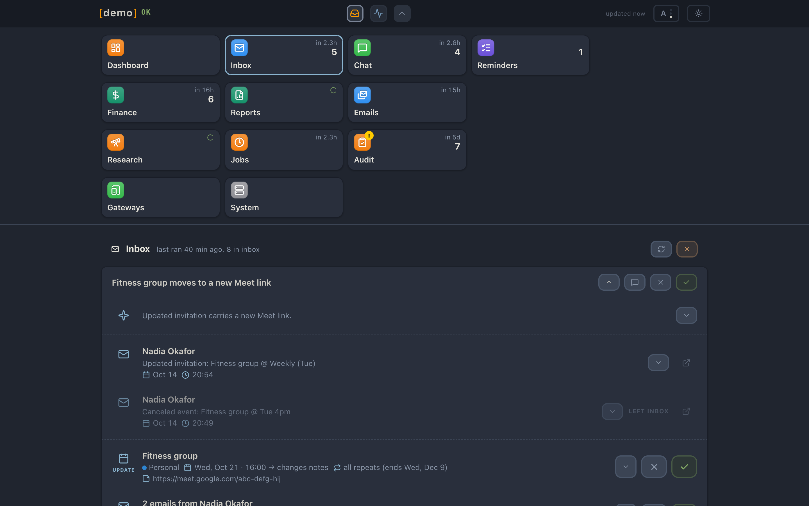

Light mode

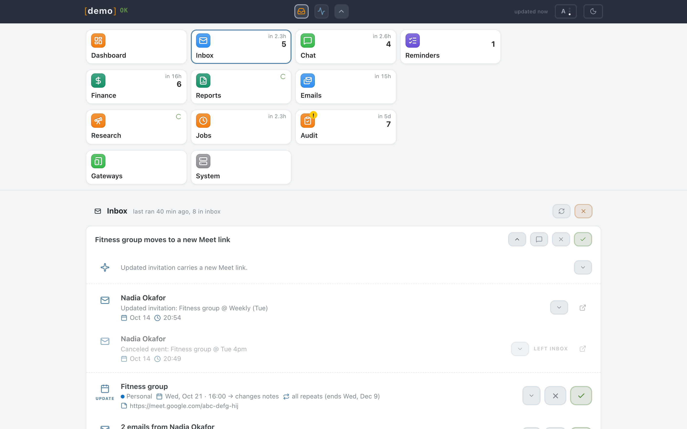

### 2.2

The areas are tiles, grouped by topic in rows. Each tile shows the next run, the open count, and a yellow badge when something needs a look. The chevron in the top bar shows and hides them:

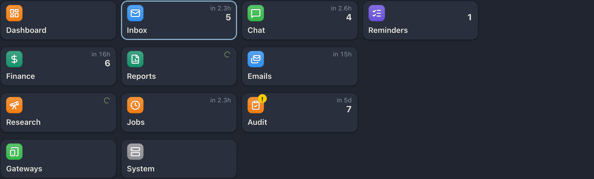

### 2.3

The bar's fold-out row has a text-size key with three sizes, kept per device. Small and large on a phone:

Dark mode

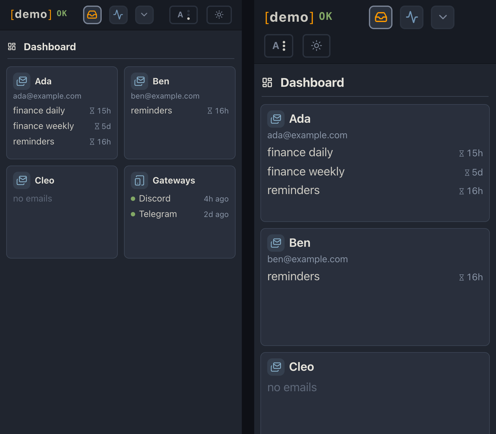

Light mode

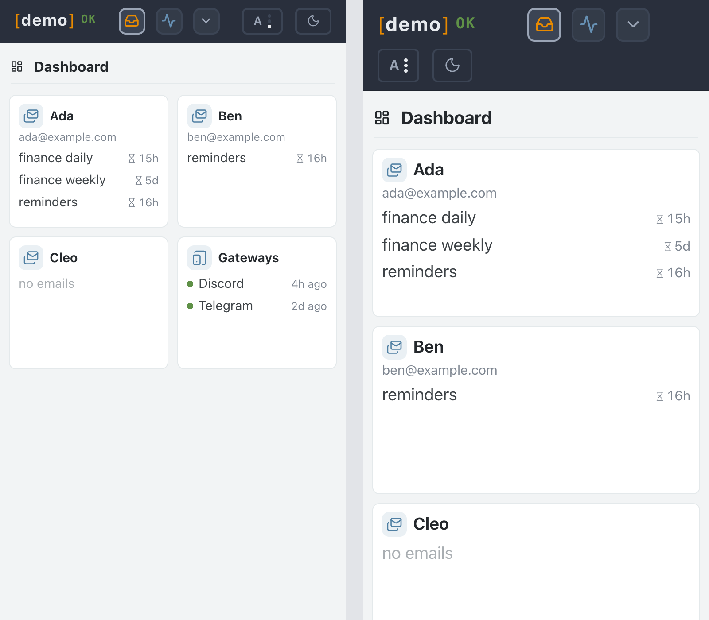

### 2.4 Example: updating a calendar event from an email

#### 2.4.1

An email arrived with a new Meet link for an event already on the calendar. The assistant explains what it found, lists the source emails, and suggests two actions: update the event, archive the emails:

Dark mode

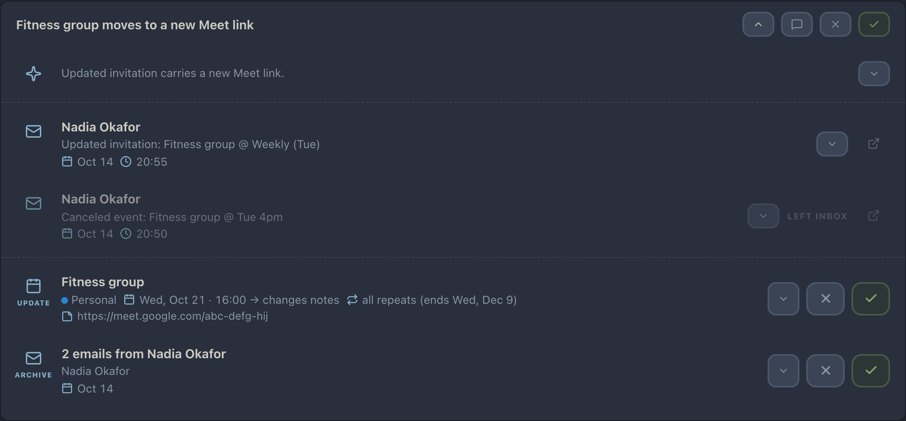

Light mode

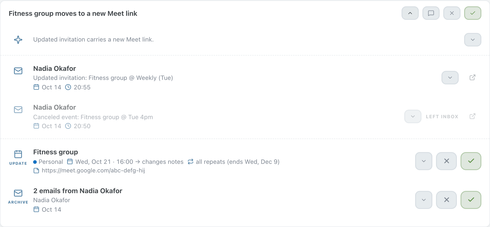

### 2.5 Example: tracking a shipment

#### 2.5.1

A shipping notice carries a tracking number; approving adds it to Parcel, the package tracker:

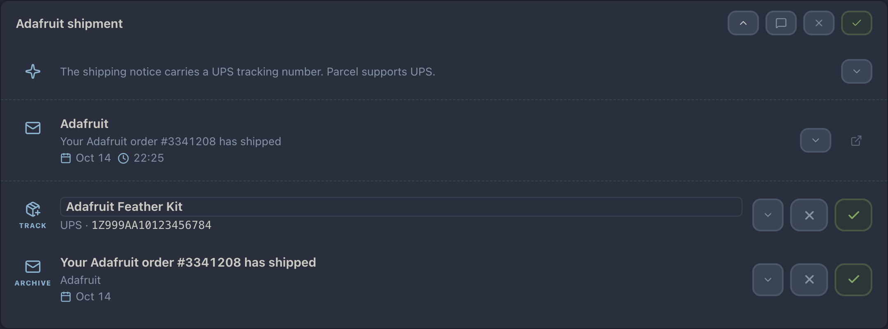

### 2.6 Example: filing documents from an email

#### 2.6.1

A portal email links an annual audit and attaches a statement. Each document gets its own copy row into the filing folder; a name already taken fails the row instead of overwriting:

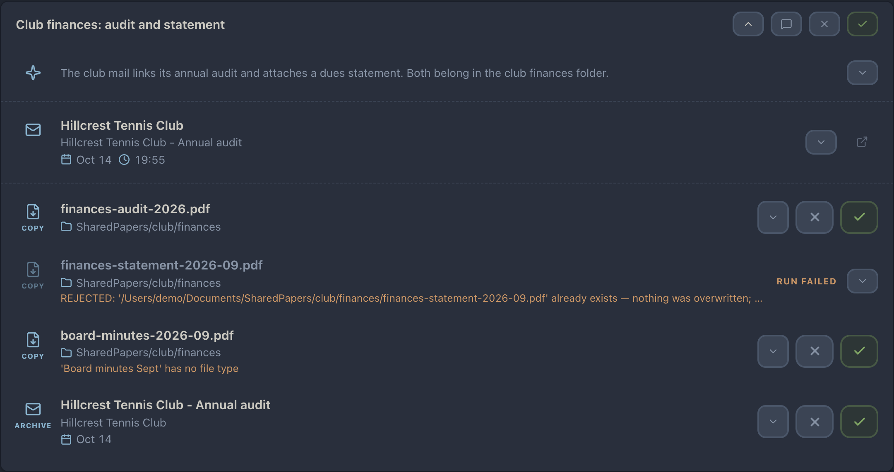

### 2.7 Example: filing a PDF from a chat

#### 2.7.1

A PDF sent in a family chat, with a guessed folder and the extracted text:

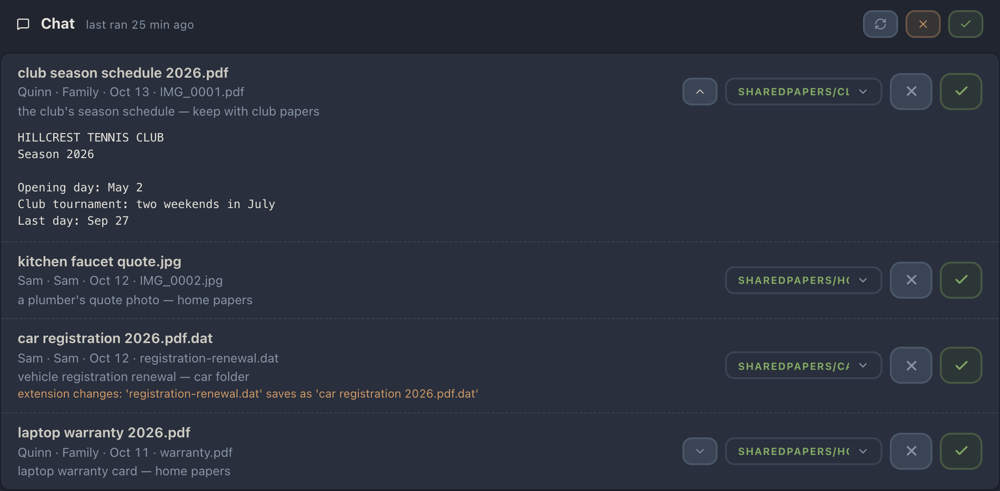

### 2.8 The reminders overview

#### 2.8.1

All my Apple Reminders lists, read-only. Not part of the action queue flow. Low effort and on this page, since:

- the Reminders MCP already works
- I already use this page for daily overview
- the native overview was lacking

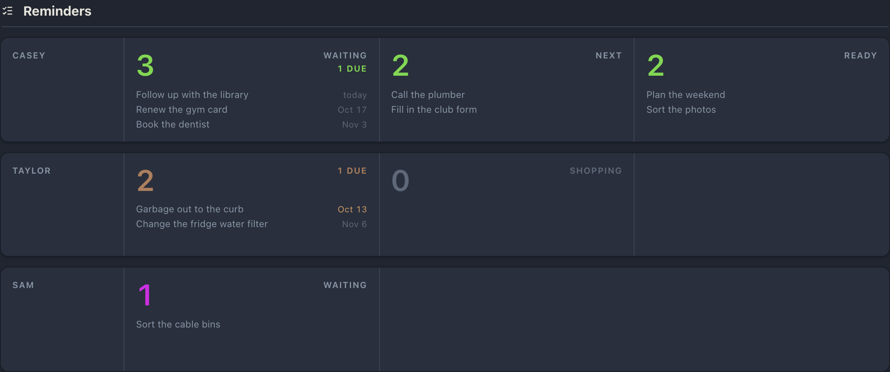

### 2.9 Family emails

#### 2.9.1

Scheduled emails per person: a daily and a weekly finance summary, and the day's chore changes from shared reminder lists. Each email row shows what was sent, a sample built from made-up rows, and its settings:

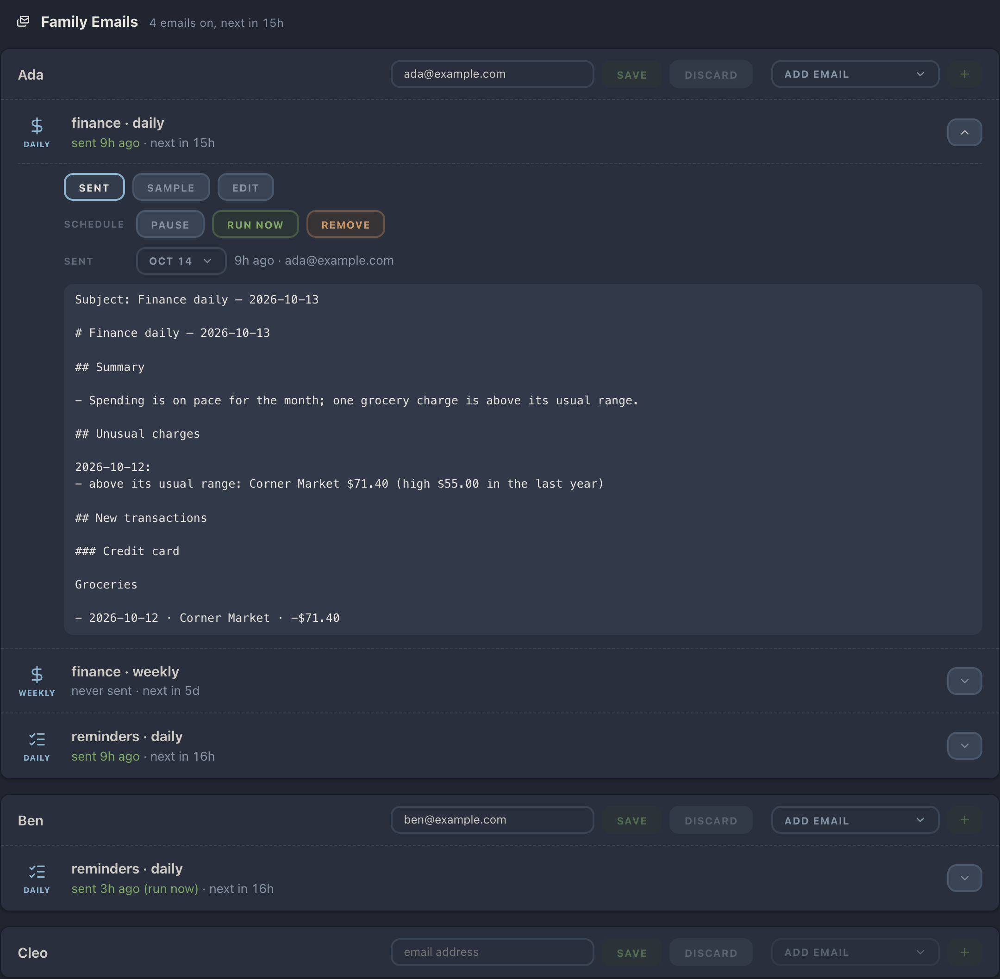

#### 2.9.2

The dashboard collects a few facts from other areas as widgets: each person's emails with their next send, and the chat gateways:

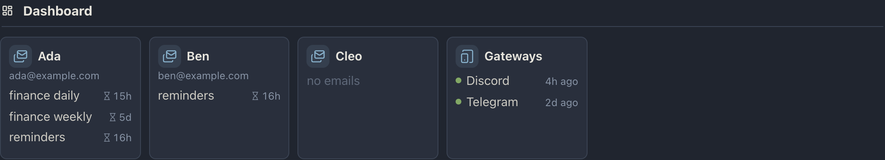

## 3 Behind the scenes

### 3.4

The jobs area lists every scheduled job with its recent durations, failures, last and next run, and a run key. A row expands to its schedule and retry log:

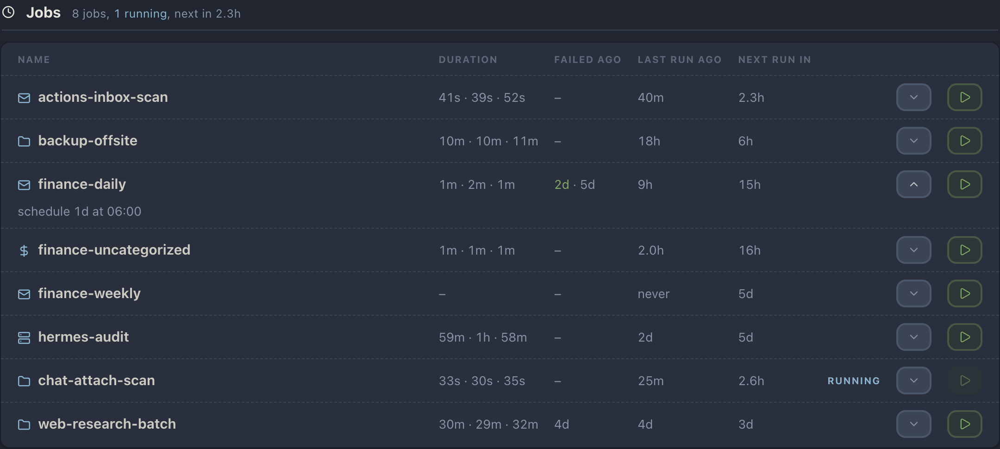

### 4.1

The overview page: which tools were called, which MCP servers and services are running, which model fills each role, and what's failing:

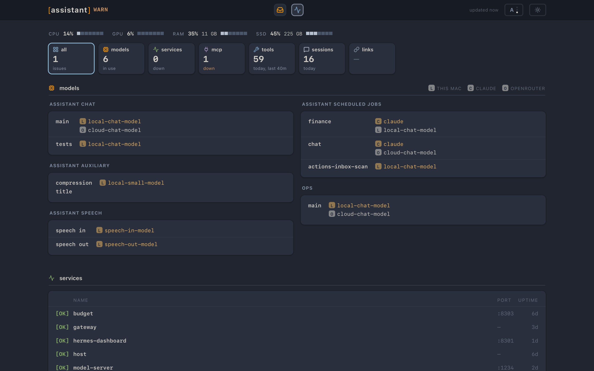

## 5 Rationale

### 5.1 Principles

- Autonomous AI actions can read data, but can't make changes or transmit anything
- Scripts are predictable and preferred over LLM when applicable
- Changes by LLM either have to go through strict guards, or get user approval

So the actions page flow is:

- scripts and LLM periodically scan emails, chats, calendar, and other changes
- suggested action cards go into a queue
- action cards run only as scripts with preset parameters (no LLM randomness at this stage)
- I approve, tweak, chat, or reject each card

Hermes and other harnesses have approval flows too, but here approvals don't expire, validation runs before and after the action, and I can preview cards at a glance.

### 5.2 Why local?

Learning by doing, plus privacy: personal data and its permissions stay on my machine.

Note: we're in the early days of LLMs — solutions can get outdated within a week, and development moves fast. Chances are good we'll be looking at a completely different stack in a few months.

### 5.3 Tech stack

- Python for the services; framework-free JavaScript and HTML for the pages, with no build step
- Hermes Agent, primarily for gateway features (in and out via chat apps). If it weren't for the gateways, [pi.dev](https://pi.dev) might have been an option too.
- macOS, for Apple Calendar, Reminders and Contacts access
- mini MCP servers: a standardized way to declare toolset APIs; also handy while I was testing different harnesses

Skipped: n8n and similar tools specialize in automation, and are worth it for more professional projects, but overkill for a personal project where a few scripts are enough.

## 7 License

[MIT](LICENSE). Icons inlined in the pages are from [Lucide](https://lucide.dev) (ISC).
